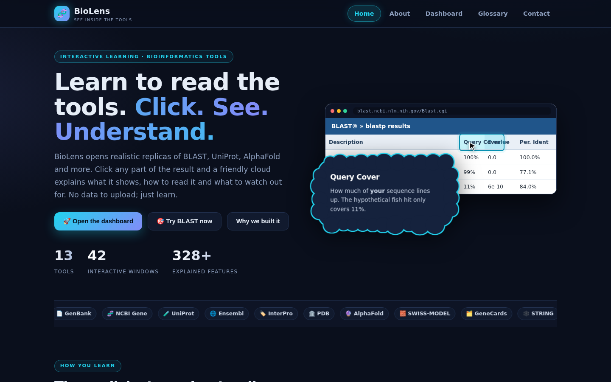
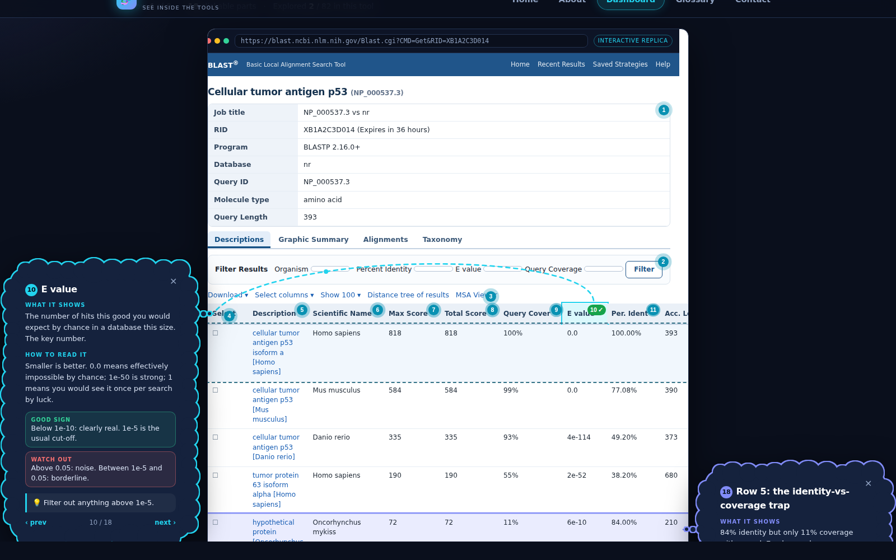

# 🧬 BioLens: learn to read bioinformatics tools

BioLens is an interactive **learning website**. It opens realistic replicas of the tools researchers use every day (BLAST, UniProt, AlphaFold, ClinVar…).
Click any numbered part of the result and an animated **cloud** explains what it shows, how to read it, good signs, warnings and the next step.
No data is uploaded and nothing is installed: it is purely for learning how to read outputs.




## Run it
**Just double-click `index.html`.** It is plain HTML, CSS and JavaScript, so it runs from a folder with no server.
(If you prefer a local server: `python -m http.server 8000` and open http://localhost:8000.)
To publish it for free, upload the folder to GitHub Pages, Netlify or Vercel.

## What is inside
**13 tools · 42 interactive windows · 328 explained features**

| Tool | Category | Windows | Features | Window names |
|---|---|---|---|---|
| BLAST | Search & alignment | 9 | 82 | Choose a program, Query & database, Algorithm parameters, Descriptions, Graphic Summary, Alignments, Taxonomy, Distance tree, Search summary |
| Clustal Omega | Search & alignment | 3 | 18 | Input form, Alignment, Identity matrix |
| GenBank | Sequence & gene databases | 3 | 32 | Record header, Features & sequence, Graphics view |
| NCBI Gene | Sequence & gene databases | 3 | 25 | Gene summary, Genomic context, RefSeq & links |
| UniProt | Sequence & gene databases | 5 | 32 | Header & function, Location & disease, Family & domains, Structure & interactions, Sequence & isoforms |
| Ensembl | Genomes | 3 | 25 | Gene & transcripts, Location view, Variant table |
| InterPro | Families & domains | 2 | 9 | Protein page, Entry page |
| PDB | Protein structure | 3 | 26 | Structure summary, Validation sliders, Sequence annotations |
| AlphaFold | Protein structure | 2 | 10 | Model & confidence, PAE plot |
| SWISS-MODEL | Protein structure | 2 | 20 | Template search, Model quality |
| GeneCards | Function & disease | 3 | 17 | Gene card summary, Disorders & expression, Genomics & proteins |
| STRING | Function & disease | 2 | 14 | Network view, Functional enrichment |
| ClinVar | Function & disease | 2 | 18 | Variant page, Submissions |

## Website pages
Home (auto-playing demo, stats, learning paths) · About (story, vision, mission, how it works, team, roadmap) · **Dashboard** (tool library with search, category filters, progress) · Glossary · Contact

## How the learning screen works
* The tool's replica window opens in the **middle** (with a typed address bar and an opening animation).
* Every clickable part has a **numbered marker**. Click one: the part glows, an **animated arrow** flies to a **cloud** on the left or right.
* Click a second part: it opens on the **other side**, so two clouds can be compared. Choose *Alternate sides* or *Nearest side* in the toolbar.
* Each cloud has *What it shows · How to read it · Good sign · Watch out · Tip*, and an optional **Expert notes** section.
* **▶ Guided tour** walks through every part (arrow keys work, Esc closes). Markers turn green when explored; each window and tool has a progress ring, and finishing a tool earns a trophy.
* Progress is saved in the browser (localStorage). On phones the cloud becomes a bottom sheet.

## Folder map
```
index.html              page shell + script list
css/style.css           theme, animations, cloud shape, replica styles
js/engine.js            the learning engine: markers, clouds, arrows, tour, progress
js/app.js               router and the pages (Home, About, Dashboard, Glossary, Contact)
js/data/glossary.js     glossary terms
js/tools/_h.js          helpers for building replica pages (tables, tracks, alignments)
js/tools/<tool>.js      one file per tool: replica HTML + every explanation
tests/check_site.py     browser test: every part has an explanation, every click opens a cloud
```

## Add or edit a tool
1. Copy any file in `js/tools/` (e.g. `clinvar.js`) and give it a new `id`, `name`, `icon`, `color`, `cat`.
2. For each window write `html: () => ...` using `H.F('key', content)` to mark a clickable part, and add `f: { key: [title, what, read, good, bad, tip, expert] }`. Use `null` for fields you do not need.
3. Add `<script src="js/tools/yourtool.js"></script>` to `index.html`. The dashboard, search, progress and tour pick it up automatically.
4. Run `python tests/check_site.py` (needs `pip install playwright && playwright install chromium`). It fails if a clickable part has no explanation, an explanation is unused, a click does not open a cloud, or the console shows an error.

## Honesty notes
Replicas are simplified and all values are **illustrative examples**; the real websites change over time. Explanations follow each tool's documentation, but always confirm real results with the original tools. Not for clinical decisions.
Edit the team details at the top of `js/app.js` (`TEAM`).
